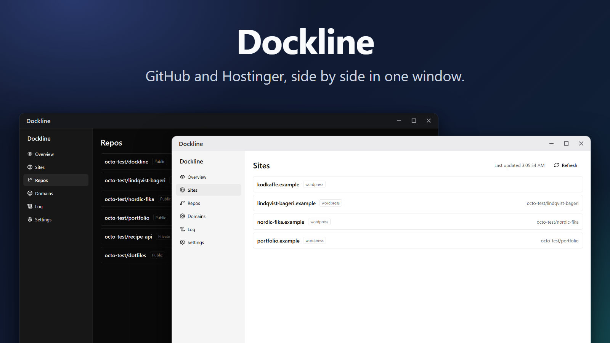
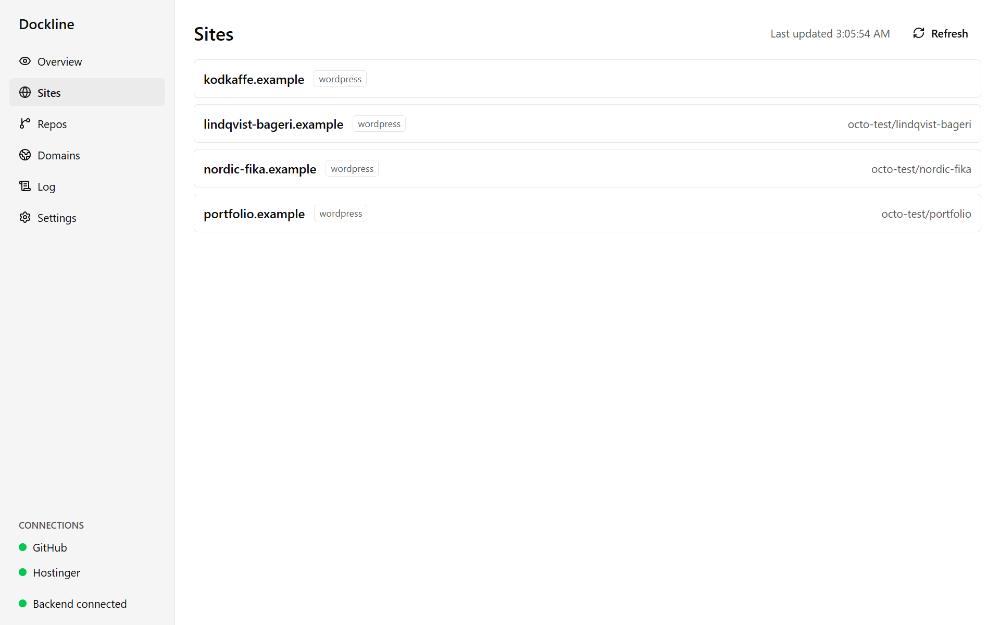
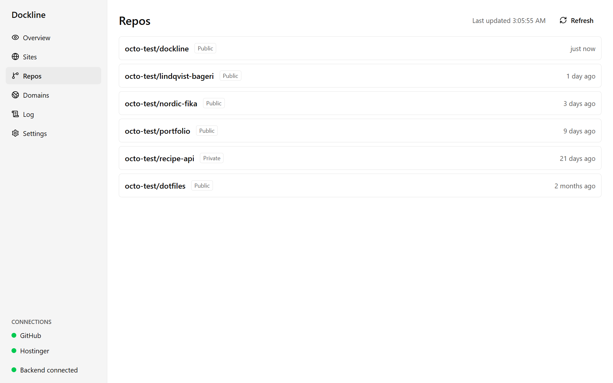
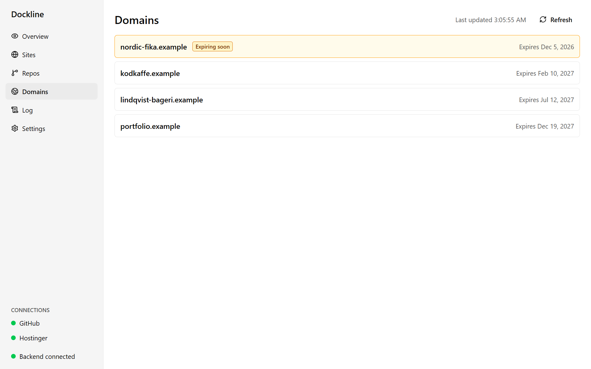
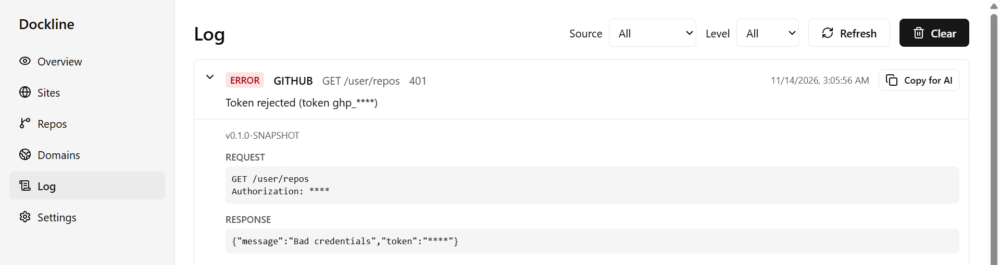
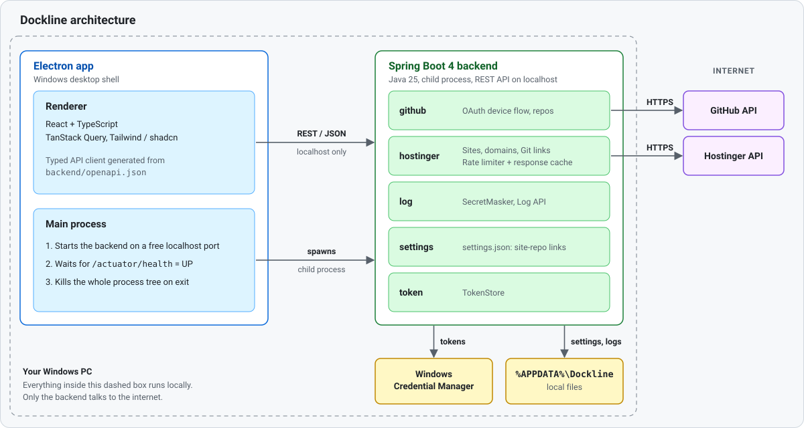
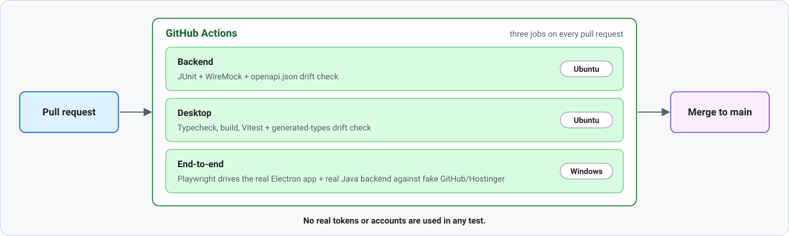

<p align="center">
  
</p>

# Dockline

**A Windows desktop app that brings your GitHub repositories and your Hostinger websites and domains together in one window.**

If you build websites for yourself or for clients, the pieces live in different places: the code on GitHub, the hosting and domains in Hostinger's hPanel. Dockline connects the two. It shows which repository belongs to which site, when a domain expires, and what went wrong when something fails, without logging in to three dashboards.

> **Status:** early development (v0.1), Windows only. The sites, repositories, domains, log and settings screens and the overview page work against the real GitHub and Hostinger APIs. Deploy, files and email are planned (see [Roadmap](#roadmap)).

## What it does

<table>
  <tr>
    <td width="50%" valign="top">
      <picture>
        <source media="(prefers-color-scheme: dark)" srcset="docs/images/sites-dark.png">
        
      </picture>
      <b>Sites.</b> Every Hostinger website with the GitHub repository behind it. The link is found automatically from Hostinger's Git connection, or set by hand for sites that are not Git-connected.
    </td>
    <td width="50%" valign="top">
      <picture>
        <source media="(prefers-color-scheme: dark)" srcset="docs/images/repos-dark.png">
        
      </picture>
      <b>Repos.</b> Your repositories (owned, collaborated on, through organizations), most recently pushed first, with public/private and last push.
    </td>
  </tr>
  <tr>
    <td width="50%" valign="top">
      <picture>
        <source media="(prefers-color-scheme: dark)" srcset="docs/images/domains-dark.png">
        
      </picture>
      <b>Domains.</b> Sorted by expiry date. A domain that expires within 30 days is marked "Expiring soon", an expired one "Expired".
    </td>
    <td width="50%" valign="top">
      <picture>
        <source media="(prefers-color-scheme: dark)" srcset="docs/images/log-dark.png">
        
      </picture>
      <b>Log.</b> Every failure from GitHub, Hostinger or the backend, with request, response and stack trace. Tokens are masked everywhere, and "Copy for AI" gives a ready-to-paste bug report.
    </td>
  </tr>
</table>

Connecting is done once in **Settings**: GitHub through the OAuth device flow (no secret to paste), Hostinger with an API token that is checked before it is saved. Tokens are kept in Windows Credential Manager, never in a file.

## How it is built

<p align="center">
  
</p>

| Part | Technology |
| --- | --- |
| Backend | Java 25, Spring Boot 4, Maven. REST API documented with OpenAPI (`backend/openapi.json`) |
| Desktop app | Electron, React, TypeScript, Tailwind CSS, shadcn/ui, TanStack Query |
| Contract | The frontend's API types are generated from `openapi.json`; CI fails if either side drifts |
| Secrets | Windows Credential Manager; a `SecretMasker` removes tokens from every log line and API response |
| Settings | One versioned JSON file, written atomically; a corrupt file is kept aside, never overwritten |

A few decisions worth knowing about (details in the [reference](docs/reference.md)):

- **The token never reaches the frontend.** The renderer only talks to the local backend; the backend talks to GitHub and Hostinger.
- **Hostinger's rate limit is respected by design.** Every Hostinger request goes through one client with a 50-requests-a-minute cap, a 60-second response cache and `Retry-After` handling. The UI shows "Rate limited, retrying in 23 s" instead of failing.
- **One failing service never breaks the other.** If Hostinger is down, GitHub still works, and each view says which source had the problem.

## How it is tested

<p align="center">
  
</p>

- **Backend:** 21 JUnit test classes against a fake GitHub and Hostinger (WireMock). Time is injected through a `Clock`, so rate-limit and cache tests never sleep.
- **Desktop:** 14 Vitest + Testing Library test files.
- **End to end:** 20 Playwright specs drive the **real** Electron app and the **real** Java backend against the fake APIs.
- **No test can reach a real account:** every external address points at a closed port unless a test supplies a fake server.

## Try it

You need Windows, Java 25 and Node 24. Maven is not needed; the Maven Wrapper downloads it.

```bash
cd backend && ./mvnw verify          # build and test the backend
cd ../desktop && npm install
npm run dev                          # start the app
```

To use "Connect to GitHub" you register a GitHub OAuth App once (about five minutes, no client secret): see [docs/github-oauth-app-setup.md](docs/github-oauth-app-setup.md). The full setup, all settings and environment variables, and every API endpoint are in the [reference](docs/reference.md).

## How the project is run

Everything is planned in [GitHub Issues](https://github.com/DelucaGit/Dockline/issues) before it is built: a PRD, epics, user stories and tasks. Each issue becomes one small pull request, and CI (backend, desktop and end-to-end tests) must pass before it is merged.

### How AI is used

Dockline is built with AI assistance (Claude Code), inside the same process as everything else:

- **Humans decide what and why.** The goals, the scope of each epic and the design decisions are written in issues first. AI writes drafts of the code for one small issue at a time.
- **Tests and CI are the control.** AI-written code is only accepted when the tests and the CI pipeline prove it works, including the end-to-end tests against fake APIs.
- **Diagnostics are made for AI too.** The Log screen has a "Copy for AI" button that produces a bug report with all secrets masked, so a failure can be handed to an assistant without leaking a token.

## Roadmap

| Epic | Goal |
| --- | --- |
| v1 Overview | See repos, sites, domains and deploy status in one window (sites, repos and domains are done) |
| v2 Deploy | Trigger deploys and control auto-deploy |
| v3 Files | Browse and manage files on my sites |
| v4 Embedded tabs | hPanel (invoices) and GitHub inside the app |
| v5 Email | Overview of mailboxes and forwarders |
| v6 What to build | See my open GitHub issues in the app |

The screenshots in this README are generated from fake data by `desktop/e2e/screenshots.spec.ts` (`DOCKLINE_SCREENSHOTS=1 npx playwright test e2e/screenshots.spec.ts` in `desktop/`), so they never show a real account.
